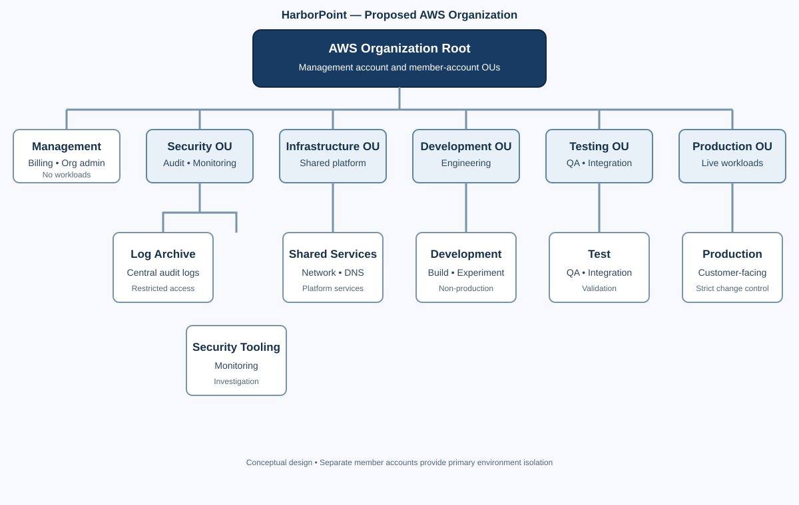

# AWS-Cloud - Harborpoint-AWS-Multi-Account-Architecture
# HarborPoint Financial Services Scenario

**Presented by: Arlan Augustin**

**Portfolio case study | Student learning project**

This case study documents my design choices as a cloud architecture student, applying foundational best practices across AWS Organizations, SCPs, and IAM policies.

> **Important:** This is a conceptual design only. No AWS resources were deployed. Names and policies are examples, not a production implementation.

## Scenario and goals

HarborPoint is moving to AWS and needs Development, Test, and Production isolation, centralized security, and consistent employee access.

## 1. AWS Organizations design



```text
AWS ORGANIZATION
|
+-- Management Account (Organizations, billing, SCP administration)
|
+-- Security OU
|   +-- Log Archive Account
|   +-- Security Tooling Account
|
+-- Infrastructure OU
|   +-- Shared Services Account
|
+-- Development OU
|   +-- Development Account
|
+-- Testing OU
|   +-- Test Account
|
+-- Production OU
    +-- Production Account
```

| Account | Purpose |
|---|---|
| Management | Manages the organization, consolidated billing, and organization-level policies. Keep application workloads out of this account. |
| Log Archive | Stores centralized audit logs, such as CloudTrail logs, with tightly controlled access. |
| Security Tooling | Supports security monitoring and investigation. |
| Shared Services | Provides shared capabilities such as networking, DNS, and approved platform services. |
| Development | Isolated environment for developers to build and experiment. |
| Test | Environment for QA, integration, and release validation. |
| Production | Runs customer-facing workloads with stricter access and change controls. |

### Why this OU design?

I separated Development, Test, and Production because each environment should have its own account boundary, resources, access rules, and operational controls. This helps reduce the chance that a mistake in a non-production environment affects Production.

Log Archive and Security Tooling are grouped in a Security OU because audit records and security operations should not be controlled only by application teams. Shared networking and platform services are grouped under Infrastructure.

An OU organizes accounts and allows policies to be applied to groups of accounts. OUs can inherit SCPs from parent OUs and the organization root. An OU is not itself a security boundary; separate AWS accounts provide the primary isolation between environments.

## 2. Workforce identity access matrix

I would use **AWS IAM Identity Center** to manage employee access centrally. Employees can be organized into groups, and permission sets can be assigned to those groups for specific accounts.

| Workforce group | AWS accounts | Proposed permission set | Reason |
|---|---|---|---|
| App Developers | Development | `DeveloperAccess` (custom) | Create and manage approved development resources. |
| App Developers | Test | `LimitedDeveloperTestAccess` (custom) | Help troubleshoot and support application testing. |
| QA Engineers | Test | `QATestOperator` (custom) | Run tests and inspect results, logs, and approved test resources. |
| QA Engineers | Development | `ReadOnlyAccess` | Review development resources without changing them. |
| Security Analysts | Security Tooling and Log Archive | `SecurityAudit` plus narrowly scoped log-query access | Review security findings and audit records without deleting logs. |
| Security Analysts | Development, Test, Production | `ReadOnlyAccess` | Inspect resource configurations during security reviews. |

A workforce group represents employees with similar responsibilities. A permission set is a collection of permissions that IAM Identity Center assigns to a group for an AWS account.

The names `DeveloperAccess`, `LimitedDeveloperTestAccess`, and `QATestOperator` are proposed custom permission sets, not AWS-managed policies. `ReadOnlyAccess` and `SecurityAudit` are AWS-managed policy examples that should still be reviewed for suitability.

I would not give developers or QA engineers standing write or administrator access to Production. Production changes should follow an approved release process. Emergency access should be limited, approved, monitored, and reviewed.

## 3. Example IAM read-only policy

For this example, I selected Amazon S3. Assume HarborPoint stores reports in an S3 bucket and wants employees to view files inside a `reports/` folder without uploading, changing, or deleting anything.

The sanitized policy is saved at [`policies/s3-reports-read-only.json`](policies/s3-reports-read-only.json).

```json
{
  "Version": "2012-10-17",
  "Statement": [
    {
      "Sid": "ListReportsFolder",
      "Effect": "Allow",
      "Action": "s3:ListBucket",
      "Resource": "arn:aws:s3:::REPLACE_WITH_BUCKET_NAME",
      "Condition": {
        "StringLike": {
          "s3:prefix": ["reports/", "reports/*"]
        }
      }
    },
    {
      "Sid": "ReadReportsFiles",
      "Effect": "Allow",
      "Action": "s3:GetObject",
      "Resource": "arn:aws:s3:::REPLACE_WITH_BUCKET_NAME/reports/*"
    }
  ]
}
```

Replace `REPLACE_WITH_BUCKET_NAME` before using the policy. It is a placeholder, not a real HarborPoint resource.

**What it permits**
- `s3:ListBucket` lets the principal list objects, with the condition limiting the listing to the `reports/` prefix.
- `s3:GetObject` lets the principal read or download objects beneath `reports/`.
- The resource ARNs scope the permissions to one bucket and its selected folder.

**What it does not permit**
- Uploading (`s3:PutObject`) or deleting (`s3:DeleteObject`) objects.
- Changing bucket settings or bucket policies.
- Reading objects outside `reports/`.
- Accessing other buckets.

**Learning point:** An IAM policy describes what an identity is allowed to do. An Allow in an IAM policy does not guarantee access: other applicable controls, such as an SCP, permissions boundary, session policy, or bucket policy, can also affect the result.

## 4. SCP analysis — CloudTrail StopLogging deny

The scenario refers to a provided CloudTrail `StopLogging` deny example. This is a common simplified example:

```json
{
  "Version": "2012-10-17",
  "Statement": [
    {
      "Sid": "DenyStoppingCloudTrail",
      "Effect": "Deny",
      "Action": "cloudtrail:StopLogging",
      "Resource": "*"
    }
  ]
}
```

This policy explicitly denies `cloudtrail:StopLogging`. If attached to an OU or account so that it applies to a member account, principals in that account cannot stop CloudTrail logging through that action.

For example, an engineer might have the AWS-managed `AdministratorAccess` policy. That IAM policy can allow many actions, but it cannot override an applicable SCP explicit deny.

The SCP can restrict IAM users, IAM roles, and the member account's root user in affected member accounts. Important boundaries:

- SCPs set the maximum permissions available to principals in member accounts; they do not grant permissions.
- An explicit deny overrides an allow.
- SCPs do not restrict principals in the AWS Organizations management account.
- SCPs do not restrict service-linked roles.
- The exact result depends on where the SCP is attached and any conditions or exceptions in the actual JSON.

**My understanding:** IAM policies say what a user or role may do, while SCPs can put organization-level limits on what principals in member accounts may do. An administrator permission set does not bypass an explicit SCP deny.

## 5. Troubleshooting — AdministratorAccess denied `cloudtrail:StopLogging`

### Likely cause

A likely cause is an explicit deny in an SCP attached directly to the account or inherited from a parent OU or the organization root. `AdministratorAccess` is an IAM identity policy; it does not override an SCP deny.

### Investigation steps

1. **Identify the principal and account.** Confirm which IAM user or role made the request, the AWS account, role session, and target trail.
2. **Read the full error.** Look for wording that identifies an explicit deny or Organizations SCP.
3. **Inspect the SCP hierarchy.** Review policies attached to the organization root, each parent OU, and the target account. Look for `cloudtrail:StopLogging`, wildcard denies, and matching conditions.
4. **Review CloudTrail evidence.** Find the failed API event and inspect its time, principal, Region, request details, and error. Do not disable or alter logging to troubleshoot.
5. **Check other controls.** Review identity policies, permissions boundaries, session policies, and relevant resource policies. Another applicable deny or missing allow may also contribute.
6. **Test safely.** Use policy simulation where applicable and test proposed changes in a non-production account. Do not weaken Production guardrails to test a theory.
7. **Follow change control.** If the deny is intentional, preserve it. If an exception is justified, have security and Organizations owners review a narrowly scoped change, test it, document approval, and plan rollback.

**Example assignment response:** Although the engineer has `AdministratorAccess`, an applicable SCP may explicitly deny `cloudtrail:StopLogging`. An explicit deny takes precedence over an allow, so the administrator policy cannot override it. I would inspect the SCPs inherited by the member account, review the failed CloudTrail event, and check other applicable permission controls. I would not remove the security guardrail without approval.

## 6. Architecture reflection — Control Tower and Landing Zone Accelerator

### AWS Control Tower

I think of AWS Control Tower as a managed foundation for setting up and governing a multi-account AWS environment. It can help establish a landing zone, organize accounts, apply baseline controls, support centralized logging, and standardize account provisioning.

For HarborPoint, Control Tower could help establish the initial multi-account structure and provide a consistent way to govern new accounts.

### Landing Zone Accelerator on AWS

I think of Landing Zone Accelerator (LZA) as an additional configuration-driven solution for implementing more detailed security, networking, logging, and compliance configurations across an AWS environment.

For HarborPoint, LZA could be considered if the organization needs more detailed controls across multiple accounts and Regions.

### How they could fit together

I would evaluate Control Tower as the foundational landing-zone service first. As HarborPoint's requirements become more complex, I would evaluate whether Landing Zone Accelerator can extend the design with additional security, networking, and compliance configuration.

They are complementary options, not simply two names for the same service. This project explains their roles only; neither service is deployed.

## 7. Assumptions, limitations, and security notes

- The exact CloudTrail SCP from the assignment was not supplied with the scenario text. This project uses a simplified explicit-deny example.
- Account and permission-set names are illustrative.
- The S3 bucket name is a placeholder and must be replaced before use.
- Custom permission sets require detailed policies based on actual job duties.
- No AWS resources were deployed.
- No credentials, customer screenshots, customer details, real account IDs, or Terraform state are included.
- This is a learning exercise, not a compliance certification or production-ready implementation.

## References

- [AWS Organizations — Service control policies](https://docs.aws.amazon.com/organizations/latest/userguide/orgs_manage_policies_scps.html)
- [AWS Organizations — SCP evaluation](https://docs.aws.amazon.com/organizations/latest/userguide/orgs_manage_policies_scps_evaluation.html)
- [IAM — Policy evaluation logic](https://docs.aws.amazon.com/IAM/latest/UserGuide/reference_policies_evaluation-logic.html)
- [IAM Identity Center — What is IAM Identity Center?](https://docs.aws.amazon.com/singlesignon/latest/userguide/what-is.html)
- [AWS Control Tower — What is Control Tower?](https://docs.aws.amazon.com/controltower/latest/userguide/what-is-control-tower.html)
- [Landing Zone Accelerator on AWS](https://docs.aws.amazon.com/solutions/latest/landing-zone-accelerator-on-aws/)
